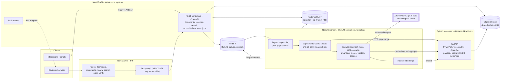
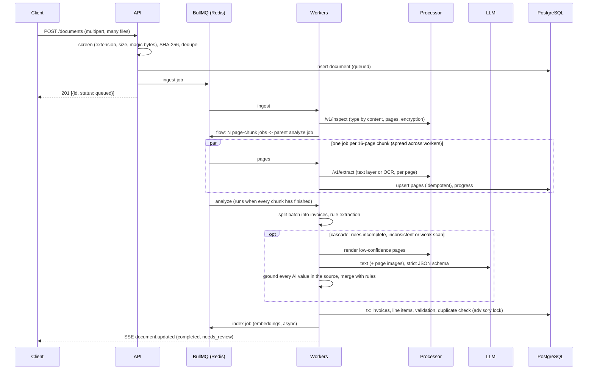

# Architecture

DocIntel turns business documents (PDF, scans, photos, Excel, CSV) into validated, searchable invoice records. A reviewer only looks at what the system flags.

## System diagram

## Processing pipeline (one document)

## Components

| Component | Tech | Responsibility |
|---|---|---|
| `apps/web` | Next.js (App Router), TanStack Query, Tailwind | Upload, live progress, review and correct, search, cross-verify. A server-side proxy adds the API key, so the browser never holds a credential. |
| `apps/api` (role `api`) | NestJS 12, class-validator, Swagger | REST API, upload screening, auth, rate limiting, search, corrections, reconciliation, SSE. |
| `apps/api` (role `worker`) | BullMQ 6 | Pipeline workers: `ingest`, `pages` (fan-out), `analyze` (flow parent), `index`. The same image as the API, started with `APP_ROLE=worker`, and scaled independently. |
| `services/processor` | Python 3.12, FastAPI, PyMuPDF, Tesseract 5, OpenCV, pandas, openpyxl, xlrd, fastembed | Stateless perception layer: content-based type detection, digital text with layout, OCR with adaptive preprocessing, spreadsheet parsing, page rendering, embeddings. |
| PostgreSQL 17 | pgvector, pg_trgm, full-text search | System of record and search engine (keyword plus vector). |
| Redis 7 | BullMQ, pub/sub | Durable job queues (AOF, `noeviction`) and progress events. |
| LLM | Azure OpenAI (`gpt-6-astra`, Responses API) or Anthropic (`claude-opus-5-5`) | Semantic extraction for hard cases, behind a provider-neutral interface. |

## Extraction design

1. **Perception (processor).** For PDFs, the text layer is used when it is usable. A quality check catches garbled ToUnicode maps; image-only, garbled or scanned pages go to OCR. Words keep their coordinates and are rebuilt into layout-preserving lines, so columns survive ("Description   Qty   Amount"). Each line keeps a normalised bounding box, which the UI uses to highlight evidence.
2. **OCR for poor scans.** The preprocessing steps run in order:
   - Despeckle with a 3x3 median filter.
   - Estimate grain with a robust MAD measure, which ignores anti-aliased glyph edges.
   - Scale to about 28 px glyphs, then apply non-local-means denoising after upscaling.
   - Stretch contrast between the Otsu ink and paper levels.
   - Remove isolated specks. Proximity is wide along the text line, so decimal points survive.
   - Deskew by projection profile, then remove thin table rules (borders make Tesseract drop whole tables).

   Weak pages get extra passes: a rotation probe for sideways or upside-down photos, adaptive binarisation and `psm 4`. The best-reading variant wins. Junk tokens from specks are filtered out, and page confidence is computed on real words only. Every decision was driven by measurements on the dev split (see `docs/EVALUATION.md`).
3. **Segmentation.** A 1,000-page batch PDF is split into invoices using these signals, strongest first: "Page 1 of N" markers, a change of invoice number, "Page N of N" closing an invoice, and an invoice header following a totals page.
4. **Deterministic extraction (rules).** This combines label vocabularies (OCR-tolerant, multilingual hints), layout columns (label beside or above value) and party blocks ("Bill To", DIN-5008 address windows, letterheads). The totals block is solved as a small constraint problem (`subtotal − discount + shipping + tax = total`); this handles cases such as "Total" printed for the pre-tax sum, and CGST + SGST. Line items come from tables with detected column roles, plus receipt patterns (`2 x 1.74   3.48`). Every value is a verbatim substring of the document with a line-level evidence pointer. The rules are fast, free and explainable.
5. **Spreadsheets.** Header detection uses synonym and snake_case normalisation, with currency hints from headers such as "Amount (EUR)". The extractor handles:
   - Registers (one invoice per row), skipping title rows and TOTAL or Count footers.
   - Line-level registers (several rows per invoice).
   - Cross-sheet joins: a "Line Items" sheet keyed by invoice number.
   - Invoice-form sheets, which are rendered to aligned text and read by the rules engine.
6. **LLM cascade.** With `LLM_STRATEGY=fallback`, the default, the model is called only when the rules result has a missing or low-confidence critical field, inconsistent totals, a weak scan, or no line items. With `always`, every invoice is read twice, by rules and by the model. The request:
   - uses strict structured outputs (a JSON schema; the strict Responses API on Azure, `output_config.format` on Claude);
   - includes a verbatim evidence quote for every field;
   - attaches page images when OCR is below 0.9 (first and last pages first, where headers and totals live);
   - delimits the document as untrusted data (prompt-injection hygiene), with no tools granted;
   - sends `store: false` on Azure.
7. **Grounding (anti-hallucination).** A value proposed by the model is accepted only if it can be traced to the source. Amounts are matched numerically in any locale; dates match under either day/month order. Names and IDs are fuzzy-matched against OCR text (85% or better). Ungrounded values are discarded and an `UNGROUNDED_VALUE` issue records the proposal. Values read only from a page image are kept, capped at 0.55 confidence and flagged `VISION_ONLY_VALUE`, which forces review.
8. **Merge.** When rules and AI agree, confidence rises and the source becomes `rules+llm`. When they disagree, the better-supported value is kept and the alternative is stored as an `EXTRACTION_CONFLICT` for the reviewer. Amount sets are kept arithmetically consistent, and line items whose sum matches the subtotal win.

## Validation and review routing

The pure rules live in `apps/api/src/validation/rules.ts`:

- **Missing fields:** `error` for invoice number, date, supplier and total; `warning` for the rest.
- **Numbers:** invalid or negative amounts, a zero total, and tax above 35% or above the total.
- **Arithmetic:** subtotal, discount, shipping and tax against the total; line-item sum against the subtotal, with 1 cent per line tolerance; quantity × unit price against the amount.
- **Dates:** in the future, before 2000, due before issue, or an ambiguous day/month order.
- **Currency:** unknown codes.
- **Confidence and quality:** low confidence on critical fields, poor OCR quality.
- **Duplicates:** checked against PostgreSQL (exact = same normalised number and a similar supplier via trigram; possible = same supplier, date and total under a different number). Documents uploaded as `reference`, meaning ledgers used for cross-verification, are excluded. The insert-and-dedupe step runs under a transaction-scoped advisory lock, so concurrent workers cannot both miss a duplicate.

An invoice is `needs_review` if it has any error, or a warning from a review-worthy set. Otherwise it is `validated`. Human corrections are audited (old and new value, actor, reason) and use optimistic locking (`version`). They re-run every rule, so fixing a total clears `TOTAL_MISMATCH`, while extraction issues on fields nobody touched are kept. Approval is blocked while errors remain, unless the reviewer overrides it with a note.

## Search

| Mode | How |
|---|---|
| Keyword | PostgreSQL full-text search (`websearch_to_tsquery`) over invoice fields and raw page text, plus trigram and ILIKE on normalised invoice numbers. Snippets come from `ts_headline`. |
| Semantic | pgvector HNSW cosine search over an invoice summary vector and over text chunks of every page. Embeddings are local (`BAAI/bge-small-en-v1.5` via fastembed), so document content is not sent out for embedding. |
| Hybrid | Reciprocal-rank fusion of both lists. |

All modes accept structured filters: status, supplier, customer, currency, date range, amount range, document, and issue code.

## Cross-verification

`POST /reconciliations` compares two processed documents: PDF vs PDF, or PDF vs Excel/CSV.

- **Pass 1** matches on the normalised invoice number, using supplier similarity to break ties.
- **Pass 2** pairs the remaining invoices by supplier, amount and date similarity (score ≥ 0.75).

Matched pairs are compared field by field (amounts within tolerance, dates, currency, parties, line counts). The report lists matches, mismatches with left/right values and the difference, invoices missing on either side, and the difference in totals.

## Scalability

- **Large PDFs.** The ingest job plans 16-page chunks (8 for scanned PDFs), so a 1,000-page PDF becomes about 63 independent page jobs. The jobs spread across all worker replicas and processor processes. The parent analyze job runs once, when every chunk has finished (a BullMQ flow). Pages are upserted as they finish, and progress is visible live.
- **Separate scaling.** API, workers and processor are stateless and scale on their own: `docker compose up --scale worker=4`, plus `PROCESSOR_WORKERS` uvicorn processes. Workers are I/O-bound (DB, LLM); the processor is CPU-bound (OCR).
- **LLM throughput.** The LLM is called once per invoice, not per page, with a per-process concurrency cap (`LLM_CONCURRENCY`). The SDK retries 429 and 5xx with backoff. The cascade keeps cost proportional to document difficulty.
- **Large files.** Files pass by storage key and are never re-uploaded between services. PDFs open lazily, page by page. Bulk inserts use `jsonb_to_recordset`.

## Reliability

- **Retries.** BullMQ retries 3 times with exponential backoff. Permanent failures (corrupt, encrypted or unsupported files) throw `UnrecoverableError` and fail immediately with a stable `error_code`. Transient failures (processor down, timeouts) are retried and marked `failed` only on the last attempt.
- **Re-runs.** A failed document is reprocessed with `POST /documents/:id/reprocess`, or in bulk with `POST /jobs/retry-failed`. Each run gets a new `run_id`, so stale jobs from an earlier run become no-ops, with no job-ID collisions. Page writes are idempotent upserts. Invoices are replaced inside one transaction per run.
- **Graceful degradation.** If the LLM is unavailable, the rules result is stored with an `AI_EXTRACTION_FAILED` info issue. If the embedding model cannot load, the processor falls back to a hashing embedder and reports it; vectors are tagged with their model, and only same-model vectors are compared.
- **Durable queues.** Redis runs with AOF and `noeviction`. Failed jobs are kept for 14 days (dead-letter set), and the full processing history is in `processing_events`.

## Security

- API-key authentication. Keys are compared as SHA-256 digests with `timingSafeEqual`, and each key's name becomes the audit actor. The web app's BFF holds the key server-side and offers optional basic auth, with the user forwarded as `x-actor`.
- Upload screening checks the extension allowlist, size limits, files per request, empty files, and executables by magic bytes. Content-based type detection runs in the processor, and extension/content mismatches are processed by content and flagged.
- Files are stored under random UUIDs outside any web root, with sanitised display names. Downloads use `Content-Disposition: attachment` and `nosniff`.
- The processor guards against path traversal (storage keys must resolve inside `STORAGE_DIR`), decompression bombs (Pillow `MAX_IMAGE_PIXELS`), zip bombs (ratio and size limits on XLSX), and caps pages and rows.
- All SQL is parameterised. Global `ValidationPipe` uses `whitelist` and `forbidNonWhitelisted`. Helmet sets security headers, CORS is limited to the web origin, rate limiting is on (`@nestjs/throttler`), and JSON bodies are capped at 1 MB.
- Document text sent to the LLM is delimited as untrusted data, the model gets no tools, outputs are schema-constrained and grounded, and `store: false` is sent.
- Containers run as a non-root user (uid 1000). Secrets live only in `.env`, which is git-ignored.

## Design decisions and alternatives

| Decision | Why | Alternative considered |
|---|---|---|
| NestJS API + Python processor | TypeScript is strong for API, queues and business rules. Python owns the best OCR and spreadsheet tooling. A stateless HTTP boundary keeps the processor horizontally scalable and easy to swap, for example for a cloud OCR service. | All-Python (FastAPI + Celery); all-Node (Tesseract.js is slower and less accurate). |
| pgvector instead of a separate vector DB | One fewer system to run. Vectors live transactionally next to the invoices they describe. HNSW handles this scale easily, and SQL filters combine with vector search. | Qdrant or Weaviate, if the corpus grows to tens of millions of chunks. |
| BullMQ flows | Native fan-out/fan-in with parent jobs, retries, backoff, a dead-letter set and Redis durability. | Temporal (more power, more operational weight); Postgres-based queues. |
| Rules + LLM hybrid with grounding | Rules are exact, explainable and free on clean documents. The LLM handles the long tail and degraded scans. Grounding stops the model from inventing values, which is a hard requirement. | LLM-only (costlier, slower, unverifiable); rules-only (brittle on new layouts). |
| Local embeddings (fastembed) | No per-query cost, no data egress, CPU-only (ONNX, no PyTorch). | Hosted embeddings, for more multilingual coverage. |
| Tesseract with custom preprocessing | Open source, CPU-only, auditable, tuned by measurement. A vision LLM is the fallback for the hardest pages. | PaddleOCR or docTR (heavier dependencies), cloud OCR (cost, data residency). |

## Limitations and next steps

- OCR on heavily degraded scans (120–150 DPI, strong blur and grain) is weak with Tesseract alone; the vision fallback recovers most of it in hybrid mode. A layout-aware OCR model, or a document-AI service, would be the next step.
- The evaluation dataset is synthetic (8 templates, 2 of them held out). Real customer documents should be added to the labelled set before production.
- Multi-tenant isolation (tenant column with row-level security), SSO/OIDC with RBAC, S3 object storage and Prometheus metrics are designed for but not implemented in this submission.
- Accounting exports (ERP connectors) and approval workflows beyond approve/reject are out of scope.
