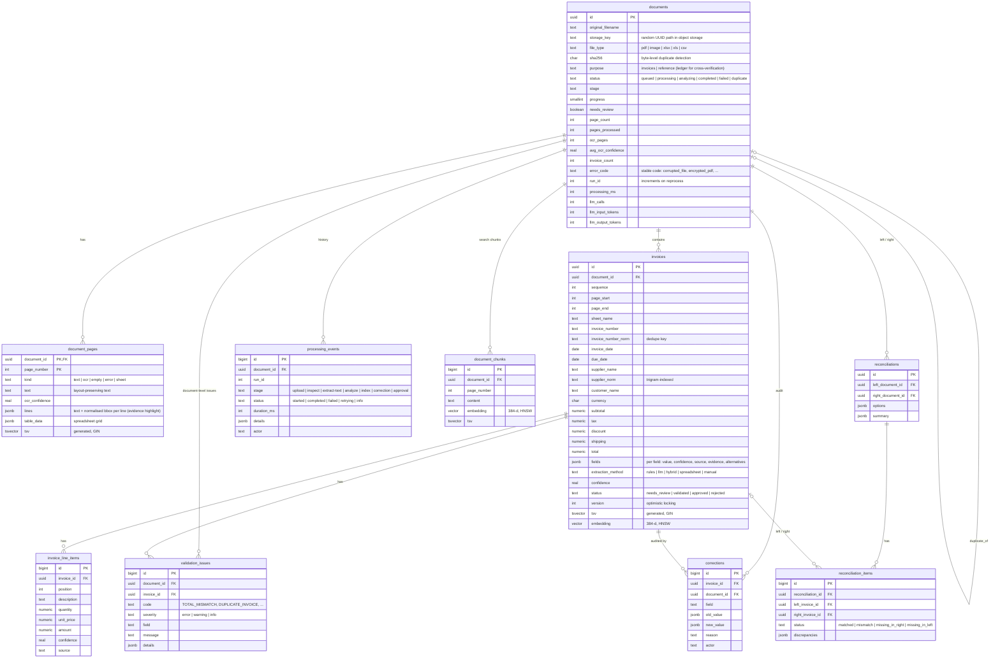

# Database schema

PostgreSQL 17 with the `vector` (pgvector) and `pg_trgm` extensions. The schema is defined in [`db/migrations/001_init.sql`](../db/migrations/001_init.sql). Migrations run automatically on start, under an advisory lock.

## Design notes

- **Money is exact.** All amounts are `numeric(18,4)`. The API and extractors use `decimal.js`, and floats are never used for money. `NUMERIC` values are returned to Node as strings.
- **Structured columns and provenance together.** Canonical values live in typed, indexed columns, used for filtering, sorting, duplicate detection and reconciliation. `invoices.fields` (JSONB) keeps each field's confidence, source, verbatim evidence (with page and bounding box) and the alternatives that were rejected. This is what the review UI shows, and what corrections update.
- **Processing history** goes into `processing_events`, append-only. It records every stage with its duration, retries with the attempt number, failures with a stable code, and corrections and approvals with the actor. `corrections` keeps old and new values; its `invoice_id` uses `ON DELETE SET NULL`, so the audit trail outlives re-extraction.
- **Idempotency.** Pages are keyed `(document_id, page_number)` and upserted, because chunk jobs can be retried. Invoices for a document are replaced inside one transaction per run. `run_id` lets workers ignore stale jobs.
- **Search indexes.**
  - Generated `tsvector` columns, with GIN indexes on invoices, pages and chunks, use the `simple` configuration, so identifiers and names are not stemmed.
  - Trigram indexes on `supplier_norm` and `invoice_number_norm` support fuzzy supplier matching for duplicates and partial invoice-number search.
  - HNSW indexes (`vector_cosine_ops`) on invoice and chunk embeddings drive semantic search; `embedding_model` prevents comparing vectors from different models.
- **Duplicate detection** uses `(invoice_number_norm, supplier_norm)` and is restricted to documents with `purpose = 'invoices'`. Ledgers uploaded for cross-verification are `reference` documents, so they do not raise false duplicates.
- **Retention.** Deleting a document cascades to everything derived from it, which supports privacy and erasure requests.
